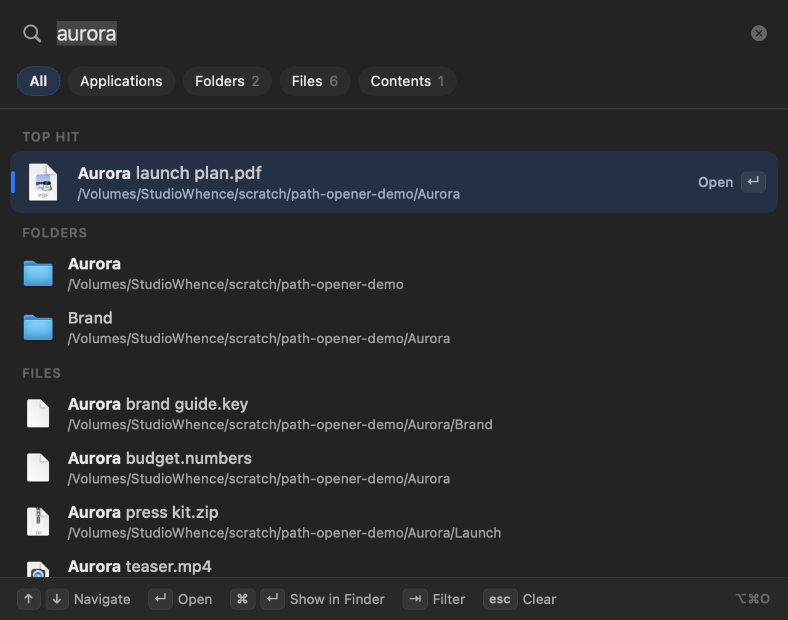
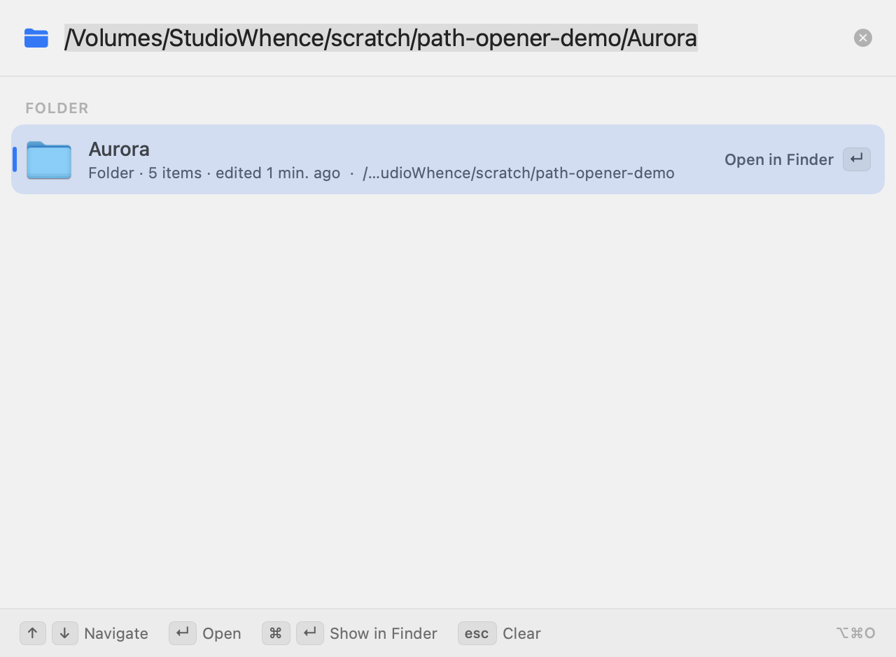
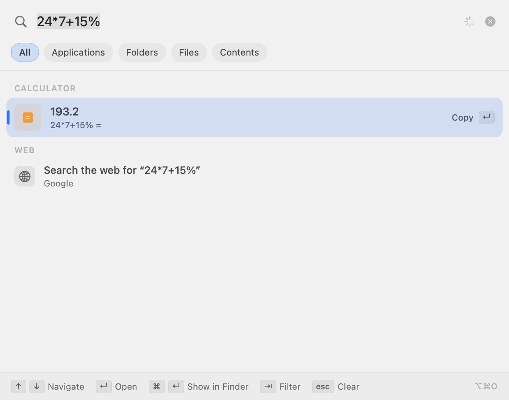
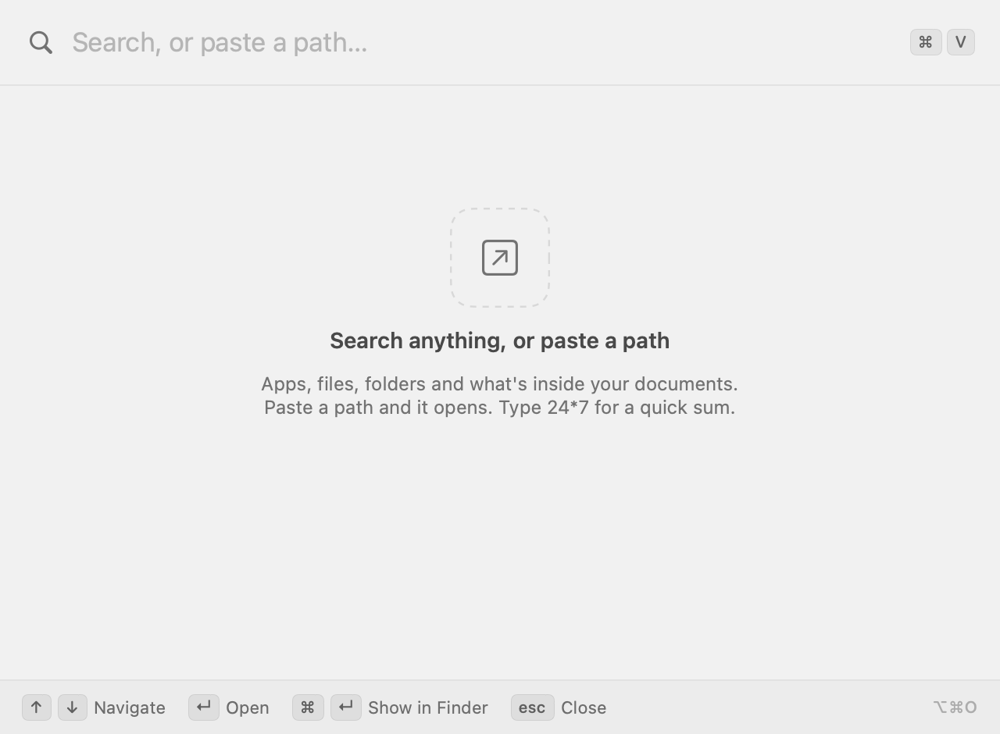

# Path Opener

A small macOS menu bar launcher. Click the icon (or press a shortcut), then:

- **Paste a path** and it opens. Files open in their default app; folders open in Finder.
- **Type keywords** to search apps, files, folders and the text inside your documents, using the same index as Spotlight.
- **Type a sum** (`24*7+15%`) and press Return to copy the answer.
- **Type a website** (`github.com`) to open it, or search the web for anything.



| Paste a path | Calculator | Empty |
|---|---|---|
|  |  |  |

## Paths it understands

Anything you'd copy from Finder, Terminal, a chat or a document:

```
/Volumes/Drive/Some Folder/report.pdf
~/Desktop
"/Users/me/My File.pdf"           quotes are stripped
/Users/me/My\ File.pdf            shell escapes are undone
file:///Users/me/My%20File.pdf    file:// links are decoded
```

If nothing exists at the path, it offers to open the closest folder that does.

When the clipboard already holds a path, opening Path Opener fills it in for you: just press Return. Pasting a full path into the empty field opens it immediately (you can turn this off in the menu).

## Keys

| Key | Action |
|---|---|
| `↵` | Open (apps launch, folders open in Finder) |
| `⌘↵` | Show in Finder |
| `↑` `↓` | Move through results |
| `⇥` | Cycle filters: All, Applications, Folders, Files, Contents |
| `esc` | Clear the field, then close |
| `⌥⌘O` | Open Path Opener from anywhere (changeable) |

Right-click the menu bar icon for: shortcut choice, Open Instantly on Paste, Launch at Login, Clear Recents, Quit.

### Using it in place of Spotlight (`⌘Space`)

1. Open **System Settings → Keyboard → Keyboard Shortcuts… → Spotlight** and untick **Show Spotlight search**.
2. Right-click the Path Opener icon → **Shortcut → ⌘Space**.

## Install

You need macOS 14 or later and the Xcode command line tools (`xcode-select --install`).

```bash
git clone https://github.com/adoistic/path-opener.git
cd path-opener
./build.sh
```

`build.sh` compiles the app, signs it ad hoc, copies it to `/Applications` and launches it. Use `./build.sh --no-install` to only build into `build/`.

A prebuilt `.zip` is attached to each [release](https://github.com/adoistic/path-opener/releases). It is not notarised, so the first time, right-click the app and choose **Open**.

## How it works

- `Sources/PathParser.swift` cleans pasted text into a real path and finds the nearest existing folder.
- `Sources/Search.swift` runs two `NSMetadataQuery` searches over the Spotlight index (names, then contents), filters out developer noise (`node_modules`, virtualenvs, caches, `Library`) and ranks results by match quality, app-ness, recent use and your own recents. It also holds the calculator and website detection.
- `Sources/Store.swift` turns the input into rows. `Sources/Views.swift` is the SwiftUI popover. `Sources/main.swift` is the menu bar item and the global shortcut.

No network access except when you choose a website or web search row. Recents are kept in the app's local preferences.

Search can only find what Spotlight has indexed. If a drive is excluded in **System Settings → Spotlight → Search Privacy**, its files won't show up (pasting their paths still works).

## License

MIT. See [LICENSE](LICENSE). Made by Adnan.
